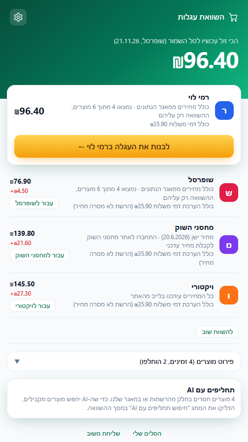
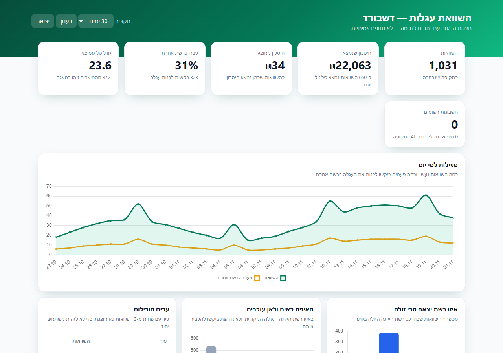

# Supermarket Cart Compare

A Chrome extension that takes the shopping cart you already filled on one Israeli supermarket site and prices the same cart at four chains (Shufersal, Rami Levy, Victory, Machsanei HaShuk), **including delivery fees and multi-buy deals**. With one click it then rebuilds the cart at the cheapest chain.

<p>
  
  &nbsp;
  
</p>

*Left: a comparison result. Right: the usage dashboard (demo data at [dashboard.html?demo=1](https://supermarket-compare-81306.web.app/dashboard.html?demo=1)).*

---

## What it does

1. **Reads the cart** on the chain's website (each site stores it differently: page state, local storage or an API).
2. **Matches products across chains** by barcode, using a product database built from the chains' public price files. Products the database does not know, such as a chain's own brand, can be matched by AI (see below).
3. **Gets live prices** from all four chains at the same time, in hidden tabs, using each site's own search API (about 10 seconds).
4. **Computes a fair total**:
   - Multi-buy deals ("2 for ₪115") are applied per line.
   - The delivery fee is checked for the user's city and street, per delivery day.
   - **Savings are computed only on products found in both chains**, so a chain never looks cheaper just because it is missing items.
5. **Rebuilds the cart** at the chosen chain. The existing cart there is emptied first, then the matched products are added.

## Data and analytics

| | |
|---|---|
| **Source data** | Israel's Price Transparency Law XML feeds, parsed by Python scripts in [`data_pipeline/`](data_pipeline) into a product table (about 5,800 products per chain) |
| **Database** | PostgreSQL on Supabase: products, per-chain prices, substitutes, AI matches, anonymous usage events, feedback, security log. All SQL migrations are in [`sql/`](sql) |
| **Dashboard** | [`public/dashboard.html`](public/dashboard.html), built with Chart.js on top of one SQL function that aggregates everything. It shows comparisons per day, savings found, which chain came out cheapest, switching between chains, top cities and top products |
| **Privacy by design** | Only totals and product names are logged, never a whole cart or a user id. A city appears only after at least 3 comparisons, so a single user can't be identified |

## AI substitutes (Gemini)

When a product is missing at some chain, the shopper can turn on **"search substitutes with AI"**:

- **Candidates come from SQL.** Postgres trigram similarity (`pg_trgm`) shortlists similar products, keeping only those sold at the chains where the original is missing.
- **The AI only chooses.** Gemini picks up to two real substitutes from that shortlist (same product type, similar size). The server rejects any answer that isn't on the list.
- **Results are saved.** Every later comparison uses the chosen substitutes automatically.
- **Limits.** It runs in a Supabase Edge Function ([`supabase/functions/ai-substitutes`](supabase/functions/ai-substitutes/index.ts)) and needs an account. It is limited to once a day per user, enforced by a database primary key. The remaining quota is shown in the extension.

## Security and quality

- **Row Level Security on every table.** Price tables are read-only for the public key, and users see only their own rows.
- **No secrets in the extension.** It ships only the public (publishable) key. The packaging script [`pack_extension.py`](pack_extension.py) builds from a fixed file list and fails if it finds a secret-looking string.
- **Accounts.** Email and password through Supabase Auth, with rate limits on sign-in. Users can delete their own account.
- **Testing.** 38 automated tests (`node --test`) cover price math, promotions, delivery fees and cart parsing. Every change is also tested in a real Chrome with the extension loaded.

## Tech stack

| Area | Tools |
|---|---|
| Extension | JavaScript (Chrome Manifest V3), HTML/CSS, Hebrew right-to-left UI, Leaflet map |
| Backend | Supabase: PostgreSQL, Auth, Edge Functions (TypeScript/Deno), Row Level Security |
| Data | Python ETL from XML price feeds, SQL (aggregations, `pg_trgm` similarity) |
| AI | Google Gemini (structured JSON output, server-side validation) |
| Analytics | Chart.js dashboard on Firebase Hosting |
| Quality | Node test runner, real-browser testing with Chrome DevTools, AI-assisted development (Claude Code) |

## Repository map

| Path | What it is |
|---|---|
| `popup.js` / `popup.html` | The comparison window: cart reading, live price agents per chain, totals, results |
| `results_view.js` | Result rendering (pure functions, unit tested) |
| `*_injector.js` | Rebuild the cart on each chain's website |
| `victory_match.js`, `rami_guest.js` | Chain-specific price, promotion and delivery-fee logic |
| `settings.html` / `settings.js` | Settings: address and branches, profile, account, privacy, feedback |
| `supabase/functions/` | The AI substitutes function |
| `sql/` | Database migrations: tables, RLS, dashboard functions |
| `public/` | Dashboard and email-confirmation page |
| `data_pipeline/` | Python scripts that built the product database from the chains' XML feeds |
| `tests/` | Automated tests |
| `docs/HANDOFF.md` | Detailed project status (in Hebrew) |

## Running it

```bash
node --test                       # run the tests
python pack_extension.py          # build dist/extension.zip
```

Unzip `dist/extension.zip`, then load the folder in `chrome://extensions` → "Load unpacked". Open a cart at one of the four chains and click the extension icon.
